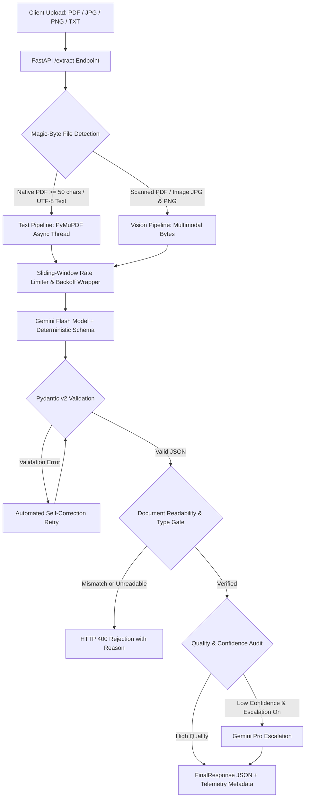

# 📄 DataExtract: Intelligent Document Extraction Engine


**DataExtract** is an asynchronous, deterministic document parsing microservice designed to eliminate manual data entry. It ingests unstructured PDFs, scanned images, and text files—specifically **Invoices, POS Receipts, and Legal Contracts**—and outputs strictly validated, database-ready JSON with field-level confidence scoring and verbatim source traceability.

---

## 🎯 Business Value & Core Capabilities

Manual data entry from vendor invoices, customer receipts, and legal agreements is slow, expensive, and prone to human error. Standard OCR tools often fail on varied layouts, while raw LLM wrappers hallucinate missing numbers.

**DataExtract solves this with a production-grade validation pipeline:**

* **Zero-Hallucination Guarantee:** Enforces strict Pydantic schemas (`InvoiceExtraction`, `ReceiptExtraction`, `ContractExtraction`) at the model level. If a field is illegible or absent, the engine deterministically sets the value to `null` with `0.0` confidence rather than guessing.
* **Source Traceability & Confidence Scoring:** Every extracted field returns both a `confidence` float (`0.0` to `1.0`) and the exact verbatim `source_text` snippet from the document, enabling instant human-in-the-loop auditing.
* **Hybrid Text & Vision Routing:** Automatically inspects file headers and extracts embedded text from native PDFs via `PyMuPDF` in milliseconds ( offloading blocking I/O via `asyncio.to_thread`), while seamlessly routing scanned PDFs, JPEGs, and PNGs to multimodal vision extraction.
* **Automated Quality Gate & Self-Correction:** Categorizes every extracted field into `complete`, `missing`, or `uncertain` buckets. Includes an automated schema validation retry loop and optional Pro-model escalation if required fields are missing or low-confidence.
* **Built-In Concurrency & Rate-Limit Protection:** Implements an asynchronous sliding-window rate limiter (`asyncio.Lock` + `deque`) and exponential backoff with jitter to handle burst traffic and upstream API spikes gracefully.

---

## 🏗️ System Architecture



---

## 📸 Screenshots & Visual Demo

> *Replace the image paths below with your actual screenshot filenames inside an `assets/` or `screenshots/` folder.*

### 1. Interactive API Documentation (Swagger UI)


### 2. Structured Extraction Output


---

## 📋 Supported Document Schemas

| Document Type (`claimed_type`) | Extracted Fields | Required Quality Gate Fields |
| :--- | :--- | :--- |
| **`invoice`** | `vendor_name`, `invoice_number`, `issue_date` (ISO 8601), `line_items` (`description`, `quantity`, `unit_price`, `line_total`), `subtotal`, `tax`, `total` | `vendor_name`, `invoice_number`, `total` |
| **`receipt`** | `merchant`, `purchase_date` (ISO 8601), `items_purchased` (`description`, `price`), `subtotal`, `tax`, `total`, `payment_method` | `merchant`, `total` |
| **`contract`** | `parties_involved` (list), `start_date`, `end_date`, `payment_terms`, `termination_clause`, `jurisdiction` | `parties_involved`, `start_date` |

---

## 📦 Sample JSON Response (`POST /extract`)

Every response includes execution telemetry (`processing_time_ms`), an automated `quality_report`, and field-level provenance:

```json
{
  "status": "success",
  "metadata": {
    "document_type": "invoice",
    "pipeline_used": "text_flash",
    "file_size_bytes": 148290,
    "processing_time_ms": {
      "file_prep_and_parsing": 14.25,
      "llm_extraction": 1840.62,
      "total_processing": 1855.10
    }
  },
  "quality_report": {
    "complete": [
      "vendor_name",
      "invoice_number",
      "issue_date",
      "line_items[0].description",
      "line_items[0].quantity",
      "line_items[0].unit_price",
      "line_items[0].line_total",
      "subtotal",
      "tax",
      "total"
    ],
    "missing": [],
    "uncertain": []
  },
  "data": {
    "vendor_name": {
      "confidence": 0.99,
      "source_text": "ACME INDUSTRIAL SUPPLY LLC",
      "value": "ACME INDUSTRIAL SUPPLY LLC"
    },
    "invoice_number": {
      "confidence": 1.0,
      "source_text": "INV-2026-0849",
      "value": "INV-2026-0849"
    },
    "issue_date": {
      "confidence": 0.98,
      "source_text": "Date: October 12, 2026",
      "value": "2026-10-12"
    },
    "line_items": [
      {
        "description": {
          "confidence": 0.97,
          "source_text": "Cloud Infrastructure Setup & Containerization",
          "value": "Cloud Infrastructure Setup & Containerization"
        },
        "quantity": {
          "confidence": 1.0,
          "source_text": "1",
          "value": 1.0
        },
        "unit_price": {
          "confidence": 1.0,
          "source_text": "$1,250.00",
          "value": 1250.0
        },
        "line_total": {
          "confidence": 1.0,
          "source_text": "$1,250.00",
          "value": 1250.0
        }
      }
    ],
    "subtotal": {
      "confidence": 1.0,
      "source_text": "Subtotal: $1,250.00",
      "value": 1250.0
    },
    "tax": {
      "confidence": 1.0,
      "source_text": "Tax (8%): $100.00",
      "value": 100.0
    },
    "total": {
      "confidence": 1.0,
      "source_text": "Total Due: $1,350.00",
      "value": 1350.0
    }
  }
}
```

---

## 🛠️ Tech Stack

* **Backend Framework:** FastAPI (Asynchronous REST API)
* **Data Validation:** Pydantic v2 (Custom `@model_validator` rules & deterministic schema enforcement)
* **AI / Vision Engine:** Google GenAI SDK (`google-genai`)
* **PDF & File Processing:** PyMuPDF (`fitz`) + `filetype` (Magic-byte header verification)
* **Deployment:** Docker & Docker Compose (`python:3.11-slim` with native `libmupdf` bindings)

---

## 📂 Project Structure

```text
dataextract/
├── main.py                # FastAPI application, async pipeline, rate limiter & routing logic
├── schemas.py             # Pydantic v2 models, confidence rules & response envelopes
├── prompt.py              # Deterministic system instructions & document-specific prompts
├── requirements.txt       # Python dependencies
├── Dockerfile             # Production container image definition
├── docker-compose.yml     # Container orchestration configuration
└── .env.example           # Environment variable template
```

---

## 🚀 Getting Started

### 1. Clone the Repository
```bash
git clone https://github.com/alishajamal/dataextract.git
cd dataextract
```

### 2. Configure Environment Variables
Create a `.env` file in the root directory:
```env
gemini_api_key=your_api_key_here
FLASH_MODEL=gemini-2.5-flash
PRO_MODEL=gemini-2.5-pro
ENABLE_PRO_ESCALATION=false
GEMINI_RPM_LIMIT=12
GEMINI_MAX_RETRIES=3
MAX_UPLOAD_MB=10
```

### 3. Run with Docker Compose (Recommended)
```bash
docker compose up --build -d
```

### 4. Or Run Locally with Python
```bash
python -m venv env
source env/bin/activate  # On Windows: .\env\Scripts\Activate.ps1
pip install -r requirements.txt
uvicorn main:app --host 127.0.0.1 --port 8000
```

Once running, open **`http://127.0.0.1:8000/docs`** in your browser to upload documents and inspect responses via the interactive Swagger UI.
